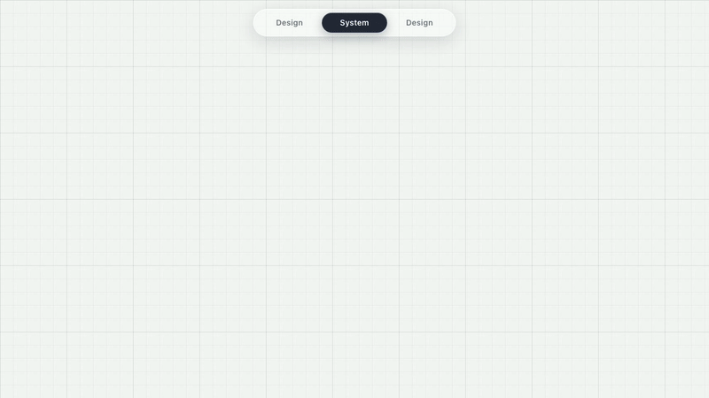

# design.system.design

**Two subjects that share a word, in one site — how to build a design system, and how to answer system design interview questions.**

`design.system.design` is a small, fast, static reference that puts two unrelated disciplines side by side. The left half explains **design systems**: what they are, how to structure them with atomic design, how to theme them, how to type and chart them, and how to keep them from rotting. The right half explains **system design**: classic interview problems broken down into requirements, estimates, an architecture diagram, the design decisions, and the follow-up questions with answers.

[📖 Design System](#features) · [🧩 System Design](#features) · [🚀 Get Started](#get-started) · [🔧 Technical Docs](AGENTS.md)



## The Problem

Two topics that sound almost identical, and get searched, spelled and explained almost identically — even though they have nothing to do with each other.

Meanwhile, both are usually explained badly:

- **Design system** advice lives in a dozen disconnected places: a conference talk about design tokens, a YouTube video on atomic design, a component library with no usage guidance, a Figma file nobody can find. Teams spend weeks rebuilding what already exists, or worse, they build the same button four times in four products.
- **System design** prep is usually a wall of videos and a list of buzzwords — "use a load balancer", "use Redis", "shard the database" — without the reasoning that turns those phrases into an answer an interviewer can actually evaluate. Candidates memorise diagrams instead of learning to derive them.

On top of that, design system material is often locked inside a company wiki, and system design material is often locked inside a paid course. Both subjects are learned better as one coherent, free, static reference you can read end to end.

## The Solution

`design.system.design` provides one focused, static reading experience: a **design system guide** and a **system design problem set**, reachable from a single landing page and signposted by a floating three-button toggle that slides a highlight across itself as you move between them.

The design system half is six chapters. The first walks the atomic design ladder in order — **tokens → atoms → molecules → organisms → templates → pages** — with the principles that justify each layer, the rules that keep it consistent and the practice that keeps it alive after launch. The other five go deep on the concerns that break real systems: tokens, typography, charts, accessibility and responsive design. The system design half walks a fixed interview framework, then applies it to five classic problems end to end.

No signup. No tracking. No cookies. Every route is a static page that renders in a few milliseconds.

## Features

### Design System

Six chapters, each with its own page — an overview, examples, rules, and a worked code sample:

- **Components** — the atomic design ladder, end to end. The six levels (**tokens → atoms → molecules → organisms → templates → pages**) with the principles that justify each layer, the practice that keeps it healthy, and a repo layout that matches.
- **Design tokens** — primitive and semantic layers, naming by purpose, generating CSS variables and other platforms from one JSON source, theming and dark mode, and how to migrate a token set without breaking consumers.
- **Fonts** — two families and one job each, a modular scale named by role, weights and measure, loading without a flash, and the typography rules that keep text readable.
- **Charts** — the parts of a chart, choosing the right form, categorical vs sequential vs diverging colour, accessible charts, responsive charts, and the empty, loading and error states nobody designs.
- **Accessibility** — WCAG 2.2 AA as the baseline, contrast, keyboard support, semantics and ARIA, motion, and the three kinds of testing that catch real problems.
- **Responsive design** — a strategy instead of a device list, breakpoints as tokens, fluid values with `clamp()`, container queries, touch targets, responsive images, and how to test the range.

The **Components** chapter also carries six **principles** (tokens not values, accessible by default, composition over configuration, constrain on purpose, document the why, treat it as a product) and six **practice** guides covering theming and dark mode, accessibility, versioning and releases, testing, documentation, and governance.

### System Design

A repeatable **framework** first — clarify requirements, estimate, sketch the API and data model, draw the high-level design, go deep on the hard parts, find bottlenecks and failures — then five problems worked through with it:

- **URL shortener** (Easy) — key generation, redirects, read-heavy caching, click analytics.
- **Rate limiter** (Medium) — token bucket, sliding window and leaky bucket, where the counters live, and how to keep them honest across servers.
- **Unique ID generator** (Medium) — UUIDs, Snowflake layouts, clock problems, and how to assign node IDs safely.
- **Distributed key-value store** (Hard) — partitioning, replication and consistency, conflict resolution, failure detection and repair, storage engines.
- **Chat system** (Hard) — connections, message delivery, storage, group chat, presence.

Each problem page carries functional and non-functional requirements, back-of-the-envelope numbers, an ASCII architecture diagram, the design decisions with their trade-offs, and a Q&A section built on native `<details>` so you can reveal answers one at a time.

### The site itself

- **A toggle, not a menu.** A floating glass bar with three buttons: **Design**, **System**, **Design**. The highlight is one absolutely positioned pill that slides and resizes between states, moves on click before the route finishes loading, and respects `prefers-reduced-motion`. It is also the logo, the favicon and the social card.
- **Design tokens throughout.** One `@theme` block in `globals.css` defines the whole palette, and the page background is a drafting-table graph paper — a 24px minor grid and a 120px major grid.
- **Real 404, error and loading pages.** A not-found page that routes you back into the material, an error boundary with a retry, a root-level critical error page, and a loading state that keeps the layout stable.
- **Every platform covered.** Multi-resolution favicon, PWA and maskable icons from 16px to 512px, an Apple touch icon, a web manifest, `robots.txt`, `sitemap.xml`, `humans.txt`, and a hand-built 1200×630 social card in both PNG and SVG.
- **Typed end to end.** Content lives in TypeScript modules, so the six chapters and five problems are checked by the compiler, not by a Markdown linter.

## Key Benefits

- **Two subjects, one site** — stop tab-switching between "design system" search results that are actually about system design, and vice versa.
- **Structured, not scattered** — a linear path through each subject instead of a feed of unranked videos.
- **Reasoning over recall** — the system design pages show the derivation, so the framework transfers to problems that are not on the list.
- **Free and permanent** — static HTML, no accounts, no paywall, no tracking, no third-party cookies.
- **Fast and private** — every route is prerendered; the whole site is a folder of files.
- **A site you can read on a phone** — one column, large type, no horizontal scrolling.

## See It in Action

Live at **[design.system.design](https://hieudoanm.github.io/design.system.design)**.

Start at the landing page, then use the toggle:

| Click           | Highlight                        | Route            |
| --------------- | -------------------------------- | ---------------- |
| middle (System) | middle button only               | `/` landing page |
| left (Design)   | left + middle = "Design System"  | `/design-system` |
| right (Design)  | middle + right = "System Design" | `/system-design` |

Read it left to right for design systems, right to left for system design.

## Get Started

The site is a static Next.js app. Clone it, install, and run:

### Prerequisites

- [Node.js](https://nodejs.org/) 26 (see `.node-version` / `.nvmrc`)
- [pnpm](https://pnpm.io/) 12

### Run it locally

```sh
pnpm install
pnpm dev
```

Then open <http://localhost:3000>.

### Build it

```sh
pnpm typecheck   # tsc --noEmit
pnpm build       # lint + type-check, then prerender all 14 routes into out/
pnpm start       # serve the static export (out/)
```

| Command          | What it does                               |
| ---------------- | ------------------------------------------ |
| `pnpm dev`       | Development server on port 3000            |
| `pnpm build`     | Lint, type-check and prerender every route |
| `pnpm start`     | Serve the static export in `out/`          |
| `pnpm typecheck` | `tsc --noEmit`                             |
| `pnpm lint`      | ESLint, with `--fix`                       |
| `pnpm format`    | Prettier, with the Tailwind plugin         |

To add content, edit the TypeScript modules under `src/content/` — a new chapter or a new problem is one file, one array entry and one sitemap line. The route, the navigation and the metadata all follow. See [AGENTS.md](AGENTS.md) for the full map.

### Deploy it

Pushing to `master` runs [`.github/workflows/ci.yaml`](.github/workflows/ci.yaml): it installs the dependencies, lints, type-checks, builds the static export and publishes `out/` to GitHub Pages. Pull requests run the same build but never deploy.

The site lives at **<https://hieudoanm.github.io/design.system.design>** because the repository is a GitHub Pages _project_ site. `site.config.json` holds that path, and it is injected into the build as the Next.js `basePath` — so every asset URL carries the `/design.system.design` prefix. Point `origin` at a custom domain and blank `basePath` in that file to move the site to a domain root.

## Use Cases

- **Learning a design system from scratch** — follow the six chapters in order and understand why each one exists before you build it.
- **Reviewing a design system you already have** — use the six principles and six practice guides as a checklist against your own component library.
- **Interview preparation** — work through the framework once, then use the five problems as timed practice and the Q&A sections as a self-test.
- **Onboarding a new designer or engineer** — hand them one URL instead of a folder of links and a wiki page.
- **Teaching the analogy** — the site is a live demonstration that "design system" and "system design" are different disciplines that happen to share a word.

## Why This Project?

- **One idea, fully realised** — two subjects, one navigation metaphor, one visual language. No third subject in the wings.
- **Static and honest** — no backend, no database, no analytics. What you see is a folder of HTML files that will still work in ten years.
- **Content as code** — everything is typed TypeScript, so a broken link or a missing field is a build error rather than a runtime surprise.
- **Consistent by construction** — the icon, the favicon and the social card are generated from the same tokens and the same two typefaces the pages use.
- **Open to contribution** — a new problem or a new chapter is a small, self-contained pull request.

## Project Status and Trust

- **Maturity:** A working reference site with all six design system chapters and all five system design problems complete. Content is still being extended.
- **Routes:** 14 prerendered pages — the landing page, a design system chapter index, six chapter pages, a system design index and five problem pages.
- **Stack:** Next.js 16.4.2 (App Router), React 19.3.1, TypeScript 6.0.3, Tailwind CSS 4.3.3, Bricolage Grotesque and JetBrains Mono.
- **Assets:** Icons at 16/32/48/64/96/128/152/167/180/192/256/384/512 plus a multi-resolution `favicon.ico`; the social card is a 1200×630 vector source with a matching PNG.
- **Privacy:** No trackers, no third-party cookies, no analytics, no accounts. Fonts are self-hosted.
- **Checks:** `pnpm typecheck` and `pnpm build` must pass before a change is considered done — the build lints, type-checks and prerenders every route into a static `out/` folder.
- **License:** [MIT License](LICENSE) — see the `LICENSE` file for full terms.

## Community and Contributions

Contributions, corrections and new problems are welcome. To propose a change, open an issue or a pull request in this repository.

- [AGENTS.md](AGENTS.md) — the technical reference: layout, routes, content model, tokens and conventions
- [Code of Conduct](.github/CODE_OF_CONDUCT.md) — the standards this project expects
- [Issue tracker](https://github.com/hieudoanm/design.system.design/issues) — bugs, corrections and proposals

Adding a system design problem or a design system chapter is a deliberately small job: one file under `src/content/`, one entry in the matching `index.ts`, one line in `public/sitemap.xml`.

## Call to Action

**[Get Started](#get-started)** — clone it, run `pnpm dev`, and read one subject end to end. Or open [design.system.design](https://hieudoanm.github.io/design.system.design) right now.

## License

This project is licensed under the [MIT License](LICENSE).
